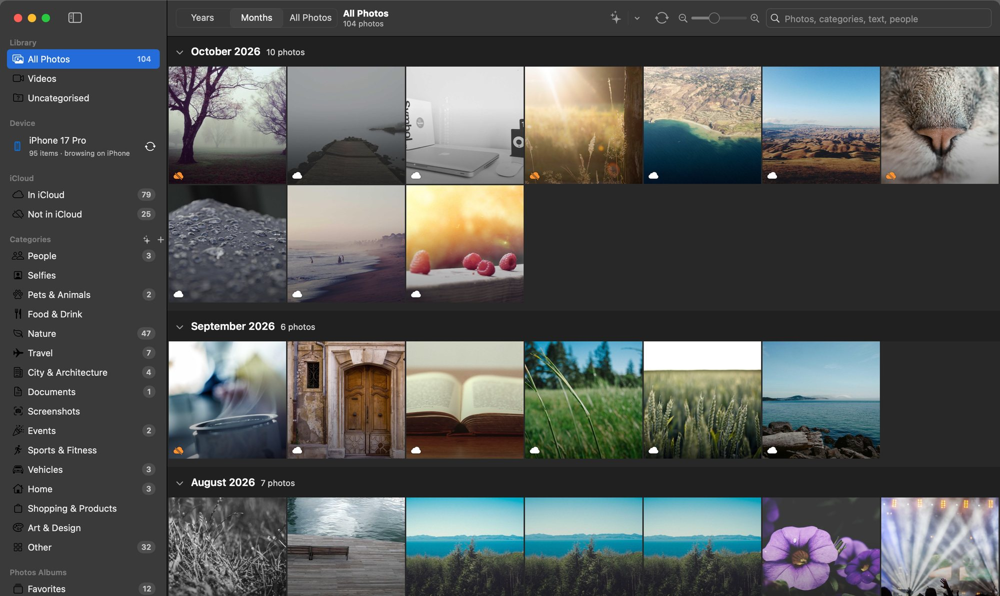
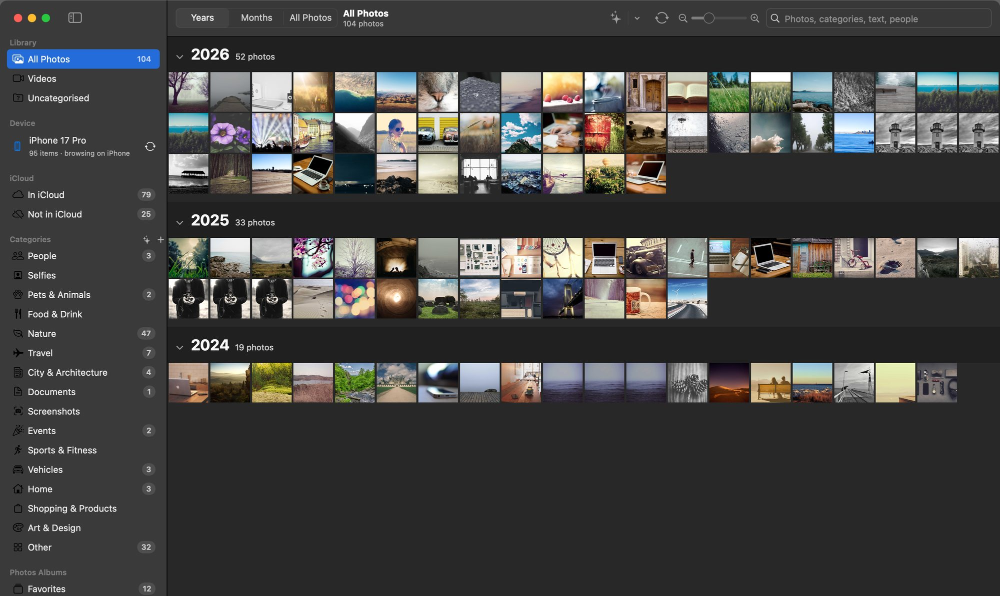
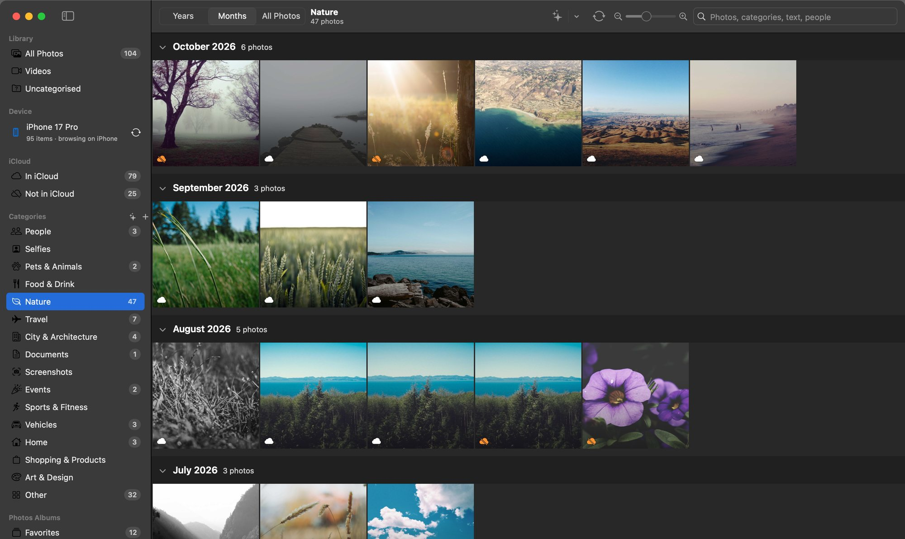
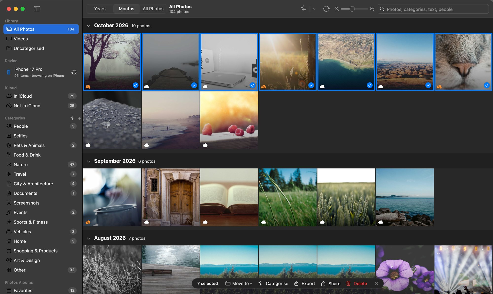
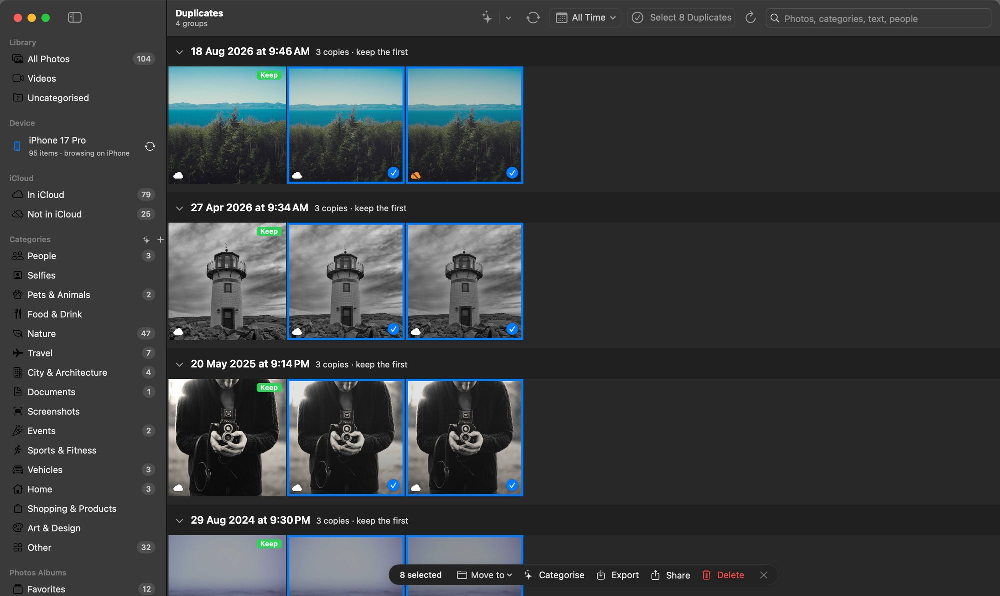
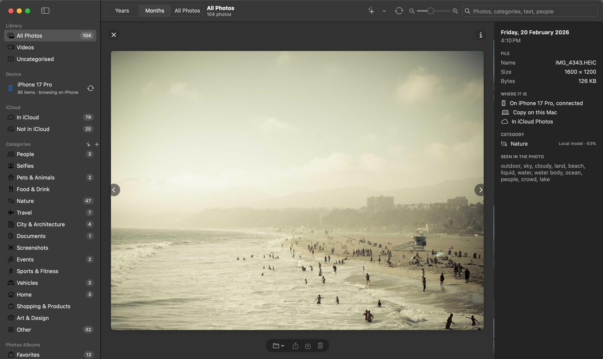
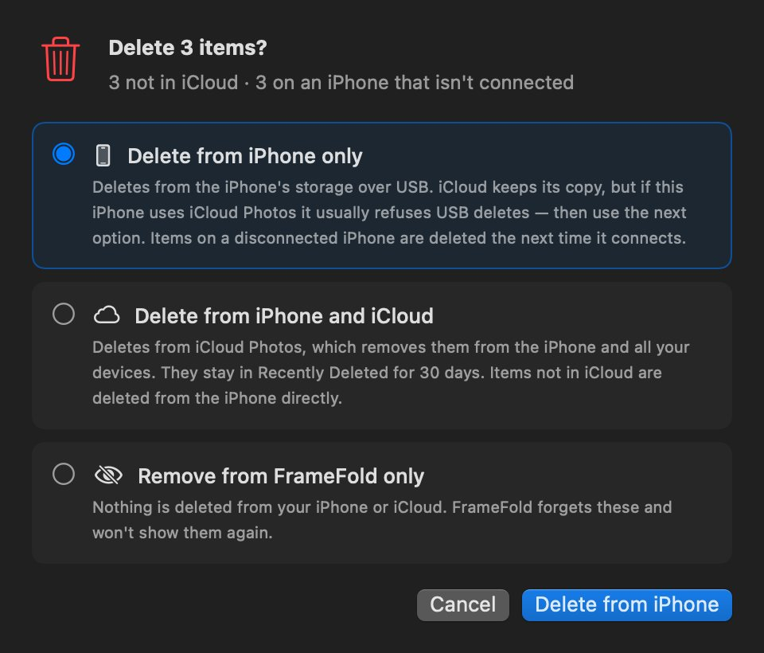
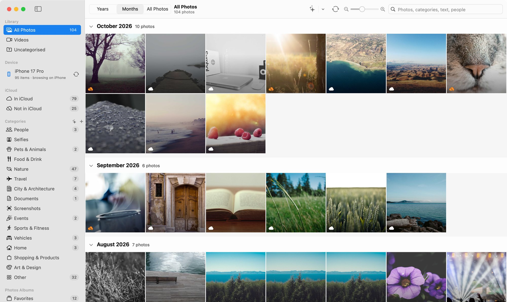
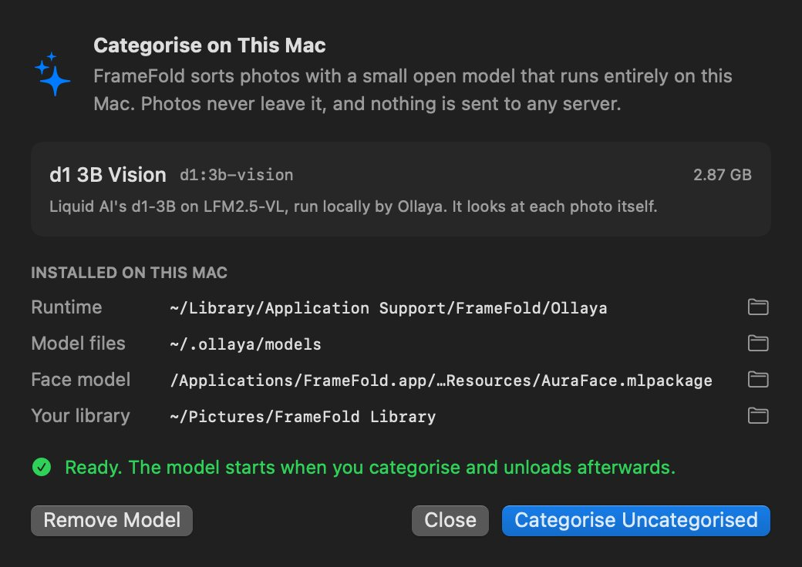

<p align="center">
  
</p>

<h1 align="center">FrameFold</h1>

<p align="center">
  <b>Browse, sort and clean up your iPhone's photos on your Mac, without copying them.</b><br>
  Native macOS app · Free and open source · Runs fully on your Mac
</p>

<p align="center">
  <a href="https://github.com/ashu5398/framefold/releases/latest"><b>⬇︎ Download for macOS</b></a> ·
  <a href="#build-from-source">Build from source</a>
</p>



Plug your iPhone in with a cable. FrameFold shows your camera roll the way Photos does: by year, by month, or everything. A small open model running on your Mac sorts it into categories. It groups people, finds duplicates, shows what is and isn't in iCloud, and lets you delete in bulk from the phone, iCloud, or just FrameFold.

Your photos stay where they are. Nothing is uploaded, nothing is stored on any server, and there is no account, tracking or analytics.

## Features

| | |
|---|---|
|  | **Photos-style browsing.** Years, Months and All Photos views with sticky date headers. Fold any month away. Zoom with a pinch, ⌘+ / ⌘− or the slider; pinching past the smallest size steps out to the next view. |
|  | **Categorised on your Mac.** One click installs the local model (d1 3B Vision, about 3 GB, once). It looks at each photo and files it under People, Nature, Travel, Food, Documents and more. Add your own categories, or move photos by hand. |
|  | **Fast selection.** ⌘-click or ⌃-click toggles, ⇧-click selects a range, ⌘A selects all. The floating bar moves, categorises, exports, shares or deletes the selection. You can also drag photos onto a category. |
|  | **Duplicates.** Exact copies and near-identical shots are grouped, with the best copy marked **Keep**. Narrow it to a date range, then **Select Duplicates** picks every other copy in that range. |
|  | **Viewer and info.** Space or a double-click opens a photo or video at full size, read from the phone on demand. The info panel shows the date, file, where it lives (iPhone, this Mac, iCloud), its category and what's in it. |
|  | **Delete with a choice.** From the iPhone only, from the iPhone and iCloud, or from FrameFold only. Deletes for an unplugged iPhone are queued until it's back. |

**Also included:**
- **People.** Faces are found and grouped on the Mac by a face-recognition model. You can rename, merge, hide, or mark a photo as "Not \<name>".
- **iCloud badges.** Each photo shows whether it's in iCloud Photos, read from the Photos library on your Mac.
- **Photos-app accuracy.** Edited photos, bursts and Live Photos show as one item each, as they do in the Photos app.
- **Light and dark mode**, keyboard shortcuts for everything (⌘/ lists them), and drag and drop in and out of the app.



## Install

1. Download `FrameFold-<version>.zip` from [**Releases**](https://github.com/ashu5398/framefold/releases/latest), unzip it, and drag **FrameFold.app** to **Applications**.
2. FrameFold isn't signed with a paid Apple Developer ID, so macOS blocks the first launch. Either:
   - open it once, then go to **System Settings › Privacy & Security** and click **Open Anyway**, or
   - run this in Terminal:
     ```bash
     xattr -dr com.apple.quarantine /Applications/FrameFold.app
     ```
3. Connect your iPhone with a cable, unlock it and tap **Trust**.

**Requirements:** a Mac with Apple silicon, running macOS 14 Sonoma or later. The local model's runtime only supports Apple silicon.

## How it works

### Your photos stay on your iPhone
FrameFold **indexes** the phone; it doesn't copy it. Each photo gets a stable ID and a small thumbnail, and everything you do (categories, people, corrections) is attached to that ID. Full-size originals are read from the phone only when you open, share or export them, and a small cache (up to 3 GB) keeps recent ones. If you'd rather have copies, turn on *Settings › Keep a copy on this Mac*.

Over USB a Mac can only read and delete an iPhone's files; it can't create albums or tags on the phone. That's why the organisation lives on your Mac.

### The local model
Categorising uses **d1 3B Vision**, run by [Ollaya](https://github.com/ollaya-dev/ollaya), an open runtime for small decision models. The first time you click **Categorise**, FrameFold sets everything up itself, with no Terminal and no admin password:

| What | Where |
|---|---|
| Ollaya runtime | `~/Library/Application Support/FrameFold/Ollaya` |
| d1 3B Vision model (≈ 2.9 GB) | `~/.ollaya/models` |
| Face model (bundled in the app) | `FrameFold.app/Contents/Resources/AuraFace.mlpackage` |
| Your index, thumbnails and analysis | `~/Pictures/FrameFold Library` |

All four locations are shown in the app, with **Show in Finder** buttons, under **Organise › Local Model…**.



The model starts only while categorising and unloads afterwards. On an M4 Pro it takes about 0.6–1 s per photo.

### iCloud status
No public API says whether a file on an iPhone is in iCloud. FrameFold compares the phone with the **Photos library on your Mac**, which mirrors iCloud when *iCloud Photos* is on in Photos › Settings › iCloud. If that's off, iCloud status shows as *unknown* rather than guessing.

## Privacy

- **Fully local.** Photos, thumbnails, faces and categories never leave your Mac. There's no server, account, telemetry or analytics.
- **Network use** is limited to the one-time model setup: the Ollaya runtime from ollaya.dev, and model weights from Hugging Face.
- **Face grouping** runs on your Mac. Face data is kept in `~/Pictures/FrameFold Library/Faces`; *Settings › Reset Library* removes it.
- **Diagnostics** (`~/Library/Logs/FrameFold`) record device operations and the phone's file list, and stay on your Mac. They're useful if you report a bug; check them before sharing.

## Things to know

- **Deleting photos is permanent on the phone** unless you choose iCloud, where photos stay in Recently Deleted for 30 days. FrameFold confirms every delete and tells you what it couldn't do, but it comes with no warranty. Keep a backup.
- **iPhones with iCloud Photos turned on** often refuse USB deletes. Use *Delete from iPhone and iCloud*, or delete on the phone.
- **Edited photos whose edit isn't exposed over USB** (some edited screenshots and videos) are skipped when deleting, because only their original is reachable. Delete those in the Photos app.
- **Hidden-album photos** come over USB with no marker, so FrameFold shows them.
- **With *Optimise iPhone Storage*** on, originals kept only in iCloud aren't on the phone, so FrameFold can't see them.
- **Indexing a large library takes a while the first time.** About 20 s to list 10,000 files, then a few thumbnails a second. It resumes where it left off.

## Build from source

You need the Xcode Command Line Tools (`xcode-select --install`). Nothing else is required.

```bash
git clone https://github.com/ashu5398/framefold.git
cd framefold
scripts/build-app.sh
open build/FrameFold.app
```

On the first build, `scripts/make-face-model.sh` runs by itself. It downloads AuraFace-v1 at a pinned revision, verifies its SHA-256, and converts it to Core ML. The conversion runs in a private Python virtual environment under `build/face-model`, using any Python 3.9–3.13, including the one that comes with macOS. That takes about 1 GB, once. `SKIP_FACE_MODEL=1` builds without it; people grouping is then turned off.

`CONFIG=debug scripts/build-app.sh` builds a debug version. The build uses `swiftc` directly, and it works around a broken module map that some Command Line Tools installs ship.

```
Sources/FrameFold/
  App/       State, menus, shortcuts, logging
  Device/    iPhone access (ImageCaptureCore), indexing and sync
  Photos/    Mac Photos library (iCloud status, albums, iCloud delete)
  AI/        Vision analysis, people, duplicates, local model
  Library/   Index, thumbnails, caches
  UI/        SwiftUI shell and the AppKit photo grid
```

## Licence and credits

FrameFold is free and open source under the [MIT License](LICENSE). Third-party components and their licences are listed in [THIRD_PARTY_NOTICES.md](THIRD_PARTY_NOTICES.md). The most important:
- **d1 3B Vision** (Liquid AI): LFM Open License v1.0. It's downloaded by you at setup, not shipped with FrameFold.
- **AuraFace-v1** (fal.ai): Apache-2.0, bundled.
- **Ollaya**: Apache-2.0, downloaded at setup.

The sample photos in the screenshots are from [Unsplash](https://unsplash.com) via [Lorem Picsum](https://picsum.photos), with credits in [docs/screenshots/PHOTO-CREDITS.txt](docs/screenshots/PHOTO-CREDITS.txt).

FrameFold isn't affiliated with Apple. iPhone, iCloud and macOS are trademarks of Apple Inc.
